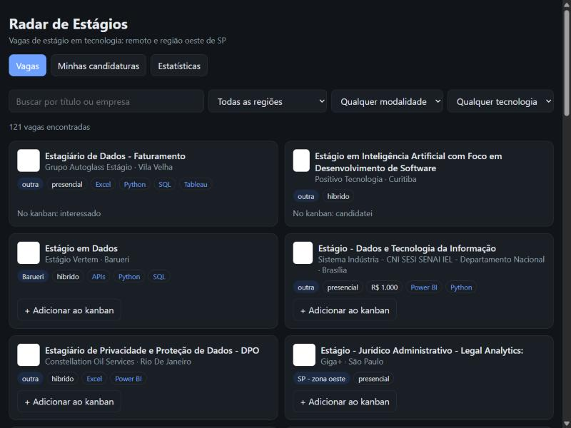
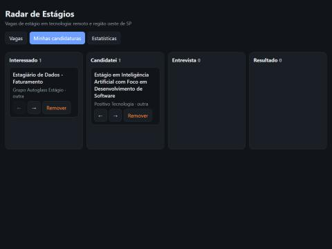
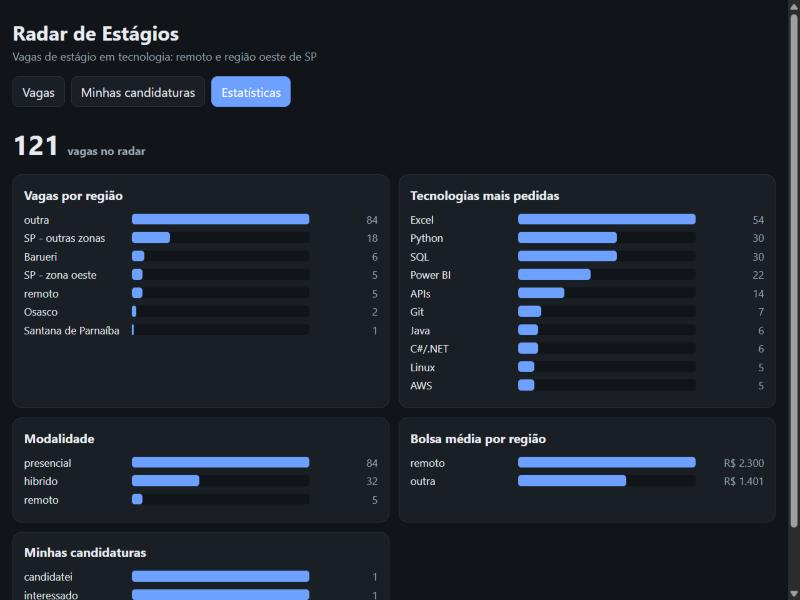
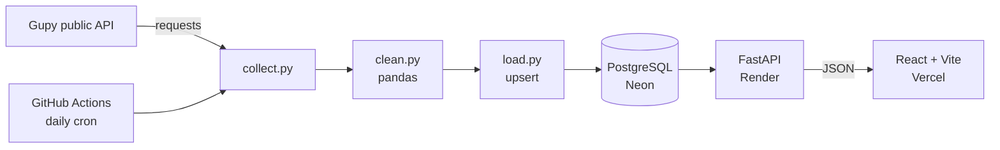

# Radar de Estágios

**Internship radar for tech students in the west region of São Paulo.** Every day it collects internship postings from Gupy's public job board, cleans them with pandas, stores them in PostgreSQL and serves them through a FastAPI API to a React dashboard with filters, an application tracker (kanban) and charts.


> 🔗 **Live demo:** _coming soon_ · **API docs:** _coming soon_ (`/docs`)
> ⏳ The API runs on Render's free plan, so the first request after a while may take **~1 minute** to wake it up.

| Job list with filters | Application kanban | Statistics |
|---|---|---|
|  |  |  |

## Why

Job boards show hundreds of postings, most of them irrelevant for a tech student who lives in Cotia. This project keeps only **tech internships**, tags each one with a **region** (remote, Cotia, Barueri, Osasco, Santana de Parnaíba, west São Paulo…) and the **technologies** it asks for, and lets me track where I applied.

## Architecture



## Features

- **Data pipeline** (`etl/`): collects postings (polite, 1 request/second), filters tech internships, normalizes city and work model, classifies the region, extracts technologies and stipend from the description with regex, deduplicates and upserts into Postgres.
- **REST API** (`api/`): filters with parameterized SQL (no SQL injection), proper status codes (`201`, `204`, `404`, `409`, `422`), CORS configured on the server.
- **Dashboard** (`web/`): filters by region, work model, technology and text; pagination; kanban with drag and drop; CSS bar charts.
- **Automation**: GitHub Actions runs the tests on every push and collects new postings every day.

## Tech stack

Python 3.12 · pandas · FastAPI · psycopg 3 · PostgreSQL 16 · React 18 · Vite · Docker Compose · pytest · GitHub Actions

## API

| Method | Endpoint | Description |
|---|---|---|
| GET | `/vagas?regiao=&modalidade=&tecnologia=&busca=&limit=&offset=` | Paginated, filtered job list |
| GET | `/filtros` | Regions and technologies (with counts) for the dropdowns |
| GET | `/candidaturas` | My tracked applications |
| POST | `/candidaturas` | Track a posting → `201`, `404` if the posting doesn't exist, `409` if already tracked |
| PATCH | `/candidaturas/{id}` | Change status and/or notes |
| DELETE | `/candidaturas/{id}` | Stop tracking → `204` |
| GET | `/estatisticas` | Counts by region, work model, top technologies, average stipend |

Interactive docs at `/docs` (Swagger UI, generated by FastAPI).

## Running locally

Requirements: Docker Desktop, Python 3.12+, Node 20+.

```bash
cp .env.example .env
docker compose up -d                      # PostgreSQL on localhost:5432 (schema applied automatically)

python -m venv .venv
.venv/Scripts/activate                    # Windows  (Linux/macOS: source .venv/bin/activate)
pip install -r requirements-dev.txt

python -m etl.pipeline                    # collect + clean + load (~1 min)
uvicorn api.main:app --reload             # API on http://localhost:8000

cd web && npm install && npm run dev      # dashboard on http://localhost:5173
```

Tests: `pytest` (API tests need the database running).

SQL practice: [`db/queries.sql`](db/queries.sql) has 20 commented queries over the real data (JOIN, LEFT JOIN, GROUP BY, HAVING, arrays, subqueries, EXPLAIN).

## Deployment (all free tiers)

- **Database:** [Neon](https://neon.tech) PostgreSQL. Tables are created by `python -m db.init_db` (also run by the pipeline).
- **API:** [Render](https://render.com) web service from `render.yaml`. Env vars: `DATABASE_URL`, `ALLOWED_ORIGINS`.
- **Dashboard:** [Vercel](https://vercel.com) with root directory `web/`. Env var: `VITE_API_URL`.
- **Daily collection:** `.github/workflows/collect.yml`, with the Neon URL stored as the `DATABASE_URL` repository secret.

## Data source

Postings come from Gupy's public job-search endpoint used by [portal.gupy.io](https://portal.gupy.io). The collector identifies itself, waits one second between requests and only stores public posting data with a link back to the original page. Applications always happen on the company's own page.

## Roadmap

- [ ] Notes field in the kanban UI
- [ ] Email/Telegram digest with new postings in my region
- [ ] More sources (other public job boards)

---

Built by [Thomaz](https://github.com/ThomazGB), a Software Development student at Fatec Cotia, with an AI pair programmer.
